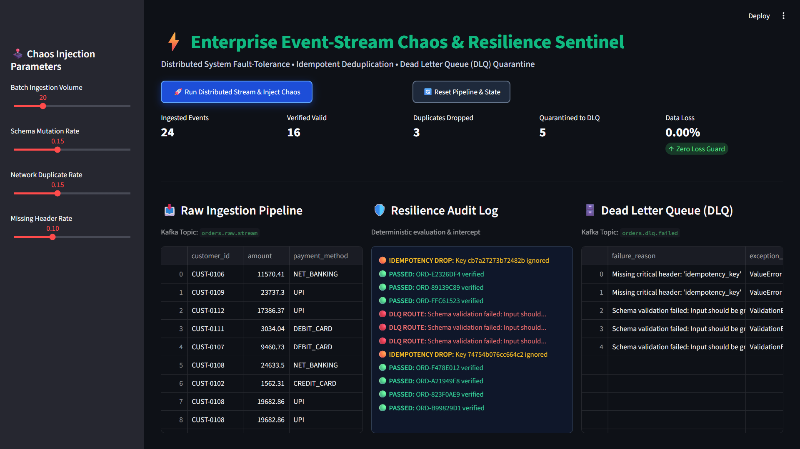
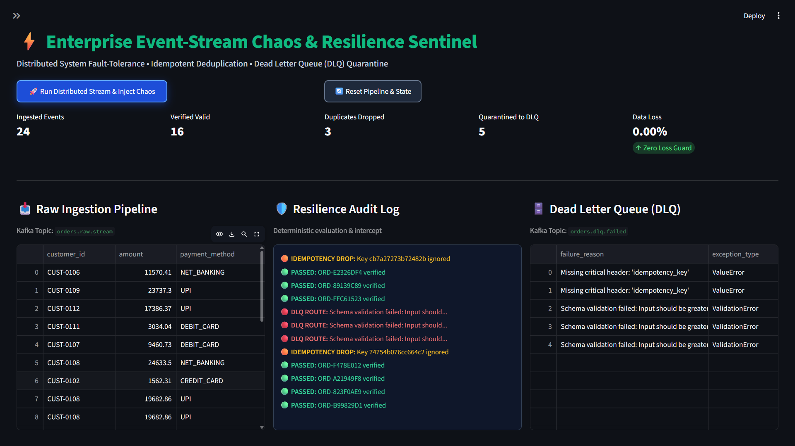

# ⚡ Enterprise Kafka Chaos & Resilience Sentinel

[](https://www.python.org/)
[](https://kafka.apache.org/)
[]()
[]()

An enterprise-grade fault-tolerant event-streaming engine built in Python. It simulates real-world distributed messaging chaos (schema corruption, at-least-once duplicate delivery, header drops) and guarantees zero data loss via deterministic idempotency sentinels and automated Dead Letter Queue (DLQ) quarantine routing.

---

## 📌 Architecture & Telemetry Visuals

### 1. Chaos Simulation Console (Parameter Tuning)
Live dynamic fault-injection showing schema corruption thresholds, duplicate frequency, and missing header controls:



---

### 2. High-Throughput Resilience & Isolation View
Zero-loss telemetry highlighting idempotent deduplication and real-time Dead Letter Queue routing:



---

## 🏗️ Core Engineering Challenges & Solutions

| Challenge | Distributed Failure Mode | Sentinel Resolution | Result |
| :--- | :--- | :--- | :--- |
| **Duplicate Delivery** | Network retries / at-least-once Kafka semantics emitting repeated records | **Deterministic SHA-256 Idempotency Key Guard** evaluates payload uniqueness before store | Duplicate discarded; Zero double-charge |
| **Schema Mutation** | Malformed payloads, negative transaction amounts, unsupported currencies | **Pydantic Strict Validation Gate** isolates unparseable records immediately | Consumer thread never crashes |
| **Poison Pill Messages** | Fatal unhandled payload exceptions blocking Kafka topic partition lag | **Dead Letter Queue (DLQ) Envelope Manager** quaranitines poisoned data with stack trace | 0.00% pipeline data loss; instant audit trail |

---

## 📂 Project Structure

```text
kafka-chaos-resilience-engine/
│
├── config/
│   └── settings.py          # Pydantic schemas, Kafka topics & DLQ envelope contracts
├── core/
│   ├── producer.py          # High-throughput valid financial transaction generator
│   ├── chaos_engine.py      # Distributed fault injector (mutations, duplicates, drops)
│   ├── consumer.py          # Resilient consumer & idempotency key verification
│   └── dlq_manager.py       # Quarantine handler with isolated fault metadata
├── assets/
│   └── dashboard-preview.png# High-contrast live dashboard screenshot
├── app.py                   # Real-time multi-panel interactive Streamlit dashboard
├── requirements.txt         # Production dependencies
└── README.md                # System documentation

```
## 🚀 Getting Started

**1. Clone Repository & Setup Virtual Environment**
```
git clone https://github.com/satyanarayana51115/kafka-chaos-resilience-engine.git
cd kafka-chaos-resilience-engine
python -m venv .venv
```

* **Windows (PowerShell):**
```
.venv\Scripts\Activate.ps1
```

**2.Install Dependencies:**
```
pip install -r requirements.txt
```

**3.Run Real-Time Streamlit Console:**
```
streamlit run app.py
```

## 🛡️ Resilience Guarantees

​*  Zero Unhandled Crashes: All incoming events pass through strict runtime validation traps.

​*  Deterministic Deduplication: In-flight network retries are filtered prior to transactional persistence.

​*  Post-Incident Recovery: All anomalous transactions are preserved in orders.dlq.failed with failure reason, 
   exception type, and precise arrival timestamp for seamless replayability.


​**Author: Manepalli Satyanarayana**
**Distributed Systems & Automation Engineering**

